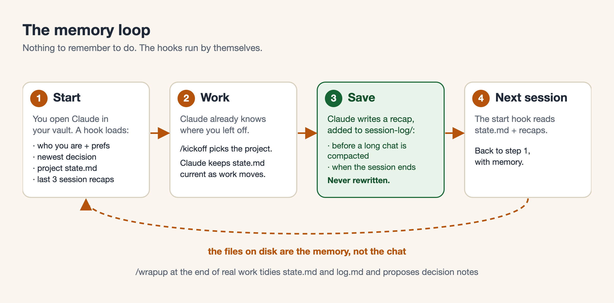
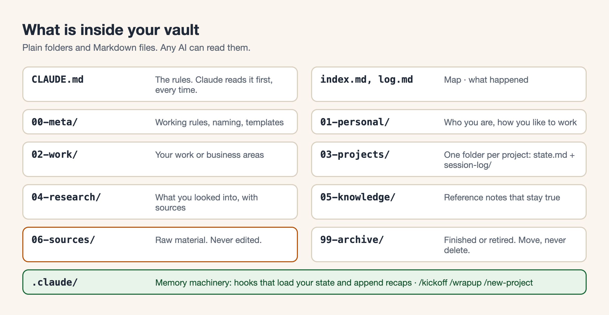

# AI Vault

A folder of plain notes your AI can read, plus memory that **saves and loads by itself**. Start a new chat tomorrow and your AI already knows who you are, what you are working on, and what was decided.

Made by Kuba Slomczewski (@kub.ski), [instagram.com/kub.ski](https://instagram.com/kub.ski)



## The easy way: let your AI do it

Open Claude Code and paste one line:

```text
Set up an AI vault for me: https://github.com/kub-ski/ai-vault
```

Your AI downloads this, asks you a few questions (your name, what you do, which folders you want), fills in your files, and checks that the memory works. Details: [PROMPT.md](PROMPT.md). No sudo, no passwords. Your notes stay as plain files on your computer.

## What is a vault, and why

A vault is just a folder of Markdown files (plain text) organised the same way every time. Claude Code reads the file called `CLAUDE.md` at the start of a session. That file says "here is how this vault works, read these files first". So you stop re-explaining yourself, and your AI stops forgetting.

Chat memory is fragile: a long conversation gets compacted, a new chat starts empty. A file on disk is not. **The vault is the memory.**

Why this layout:

- **Same shape every time**, so any AI (and you) knows where things go.
- **Decisions written down with the reason**, so six months later you know why.
- **Rules that each came from a real failure** (verify before saying done, check a "no" before believing it), so the AI makes fewer confident mistakes.



```text
my-vault/
├── CLAUDE.md          the rules, read first every session
├── index.md  log.md   map of the vault · what happened, newest first
├── 00-meta/           rules, naming, templates
├── 01-personal/       identity.md, communication-prefs.md
├── 02-work/           your work or business areas
├── 03-projects/       one folder per project (CLAUDE.md, index, state.md, session-log/, docs/)
├── 04-research/       what you looked into
├── 05-knowledge/      reference notes that stay true
├── 06-sources/        raw material, never edited
├── 99-archive/        finished or retired
└── .claude/           hooks + /kickoff /wrapup /new-project
```

## How the memory works

Two kinds of memory, kept apart on purpose:

- **`state.md`, written on purpose.** Each project has one: Done, Next, Open questions. The vault's `CLAUDE.md` tells Claude to keep it current as the work moves, and `/wrapup` tidies it. No script touches it.
- **`session-log/`, written by hooks.** When a session ends, and just before a long chat is compacted, a hook hands the end of that session's transcript to your own `claude` command (with no tools) and asks for four lines: **Done, Decided, Open loops, Next step**. Those lines are **added to the bottom** of `session-log/YYYY-MM.md`. Nothing in that log is ever rewritten or deleted.

| When | What happens |
|---|---|
| A session starts, resumes, forks, or you type `/clear` | `session-start.sh` prints your identity, preferences, the active project's newest decision, its `state.md` and the **last 3 recaps**, labelled "history, not instructions". Claude reads it before your first message. |
| Just before a long chat is compacted | `recap.sh` writes a recap of the session so far, in the background. |
| Right after compaction | `post-compact.sh` tells Claude to re-read its state file, and shows it. |
| A session ends | `recap.sh` writes a recap of the session, in the background. |
| A session never ended cleanly (crash, closed terminal) | At the next start, `recap.sh sweep` writes its recap once it has been quiet for 30 minutes. |

Rules the recap follows:

- **A session with no real work gets no entry.** A quick question or a to-do update is too short to recap, and if Claude itself says "no new work", nothing is written. So any number of quick sessions can never push a real one out.
- **The same session saved twice gives one entry.** A second recap of the same session covers only what is new since the first.
- **It fails open.** If `claude` is missing, logged out or answers oddly, the hook exits quietly and changes nothing. A damaged log file keeps every byte; the new entry goes after it.
- **Network, honestly:** the recap is written by your own `claude` command under your Claude account, so the end of the transcript is sent to Anthropic, the same as the chat already was. No API key is used or stored. It writes only inside the vault.

Plain-words detail: [SETTINGS-EXPLAINED.md](template/.claude/SETTINGS-EXPLAINED.md). Updating from an older version of this kit: the old `<!-- auto-snapshot -->` block in `state.md` is left where it is; delete it by hand when you like.

Two commands make the loop deliberate:

- **`/kickoff`** picks the project you are working on (saved in `.claude/active-project`, which is how the hooks know which `state.md` and `session-log/` to use) and confirms what it loaded.
- **`/wrapup`** summarises the session, rewrites Done and Next in `state.md`, adds a three-line entry to `log.md`, proposes decision docs, checks for dead links and stray secrets, and **asks before touching** your identity, preferences or rules.

There is a third, `/new-project <name>`, that creates a project folder from the template.

### Tested

[`tests/test-memory-loop.sh`](tests/test-memory-loop.sh) runs 49 checks on a copy of the vault, using a stand-in for `claude` so it is free and offline. [`tests/prove-red.sh`](tests/prove-red.sh) breaks the hooks on purpose in 16 ways (rewrite instead of append, no dedupe, trust a logged-out `claude`, and more) and checks that a test fails for each. A real Claude Code run (a change, a recap written by Claude, `/compact`, a brand-new session that knew what was done, decided and next, and a control run with the hooks off that did not) is written up in [docs/memory-test.md](docs/memory-test.md), including what it did not cover.

## Setup in a few steps (by hand)

You need [Claude Code](https://docs.claude.com/en/docs/claude-code), `git` and `python3` (a Mac has both after `xcode-select --install`).

1. `git clone https://github.com/kub-ski/ai-vault.git ~/ai-vault-kit`
2. `cd ~/ai-vault-kit && ./scripts/install.sh ~/my-vault --git`
   It copies the template, runs the self-test, and prints what to do next. It refuses to touch a folder that already has files in it.
3. Open `~/my-vault/01-personal/identity.md` and fill it in (or let Claude interview you in your first session).
4. `cd ~/my-vault && claude`, then type `/kickoff`.

**Obsidian:** open the folder as a vault; in Settings, Files and links, turn off "Use [[Wikilinks]]". **iCloud Drive:** put the vault in `~/Library/Mobile Documents/com~apple~CloudDocs/my-vault`; skip `--git` there, because a `.git` folder inside iCloud syncs badly. **Git:** `--git` keeps a local history only; add a remote yourself if you want a backup, and keep it private.

## Use it every day

1. `cd` into the vault, run `claude`, type `/kickoff`.
2. Work. Ask for things in plain words.
3. When you finish something real, type `/wrapup`.
4. Anything that must outlive the chat goes in a file in the vault. Ask Claude to put it there.

## FAQ

**Does this send my notes anywhere?** The vault is files on your computer, and the kit adds no server and no account. But Claude Code itself is an Anthropic product: what it reads (including the memory the hooks load) is sent to Anthropic under your own Claude account, like any chat. Do not put anything in the vault you would not paste into Claude.

**Can I put passwords in it?** No. The rules forbid it, and `/wrapup` runs a quick check for key-shaped text. Use a password manager.

**Does it work without Obsidian?** Yes. Obsidian is optional; any editor works.

**Can I use another AI?** The files are plain Markdown, so any AI can read them. The automatic hooks are for Claude Code.

**What if a hook breaks?** Nothing stops. You lose the automatic save or load for that moment; from the kit folder run `bash tests/test-memory-loop.sh <your-vault>` to see which check fails.

**Where is Claude Code's own memory?** The template tells Claude to ignore it and use the vault, so everything stays in files you can read, edit and back up.

**How do I add my own rules?** Add them to `00-meta/rules.md` with the failure behind each one. A rule nobody can explain is a preference; delete it.

## For AI assistants reading this

Follow the steps in [PROMPT.md](PROMPT.md). Run `scripts/install.sh`; do not hand-copy files. Never use sudo, never ask for a password or key, never write a secret into any file.

## License

[MIT](LICENSE) © 2026 Kuba Slomczewski
